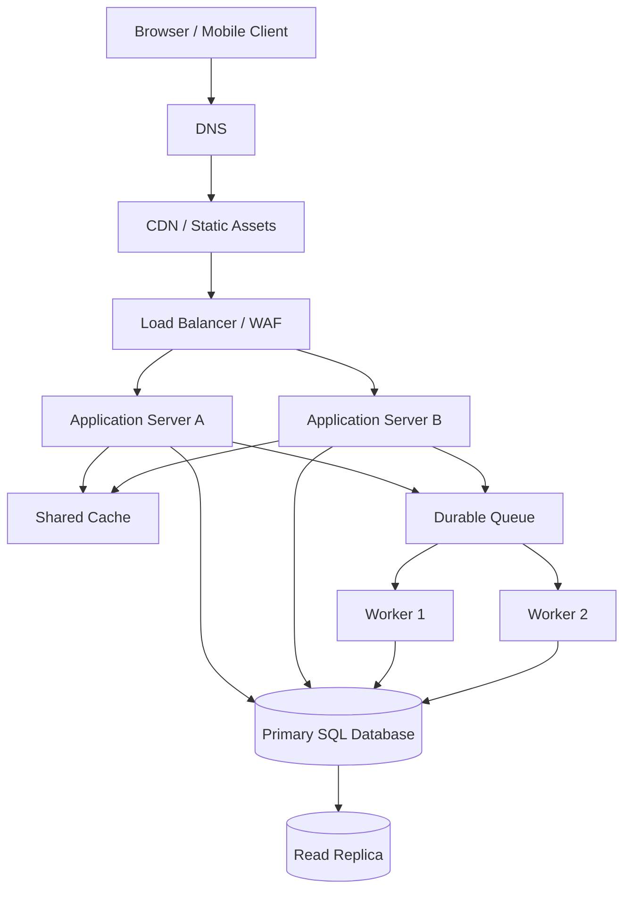

# QuickNotes System Architecture

## Scope and assumptions

QuickNotes is moving from a browser-only app to an online service for **1 million registered users**. The estimates below are planning assumptions, not measured production traffic. Assume 10% of registered users are active on an average day, each active user makes 50 reads and 5 writes per day, and a day has 86,400 seconds.

## Requirements

### Functional requirements

- Users can register, sign in and sign out.
- Authenticated users can create, read, update and delete their notes.
- Users can tag notes and search or filter their own notes.
- The service validates input and returns consistent JSON errors.
- Users can access notes across devices after signing in.

### Non-functional requirements

- Protect user data with HTTPS, authentication and authorization.
- Keep normal read requests responsive (initial target: p95 under 300 ms, subject to measurement).
- Scale application capacity horizontally.
- Back up the database and test recovery procedures.
- Monitor latency, errors, saturation and queue lag.
- Avoid a single machine or process being required for all requests.
- Maintain data integrity through database constraints and transactions.

## Load estimate for one million users

Assumptions: 1,000,000 registered users; 10% daily active = 100,000 active users; each active user averages 50 reads and 5 writes per day.

- Daily reads = 100,000 × 50 = 5,000,000.
- Average reads/second = 5,000,000 ÷ 86,400 ≈ **58 reads/second**.
- Daily writes = 100,000 × 5 = 500,000.
- Average writes/second = 500,000 ÷ 86,400 ≈ **5.8 writes/second**.
- Planning for a 10× busy-hour peak gives roughly **580 reads/second and 58 writes/second**.

For storage, assume each note and its row/index overhead averages 2 KB, and each active user creates 5 notes per day. Annual new notes = 100,000 × 5 × 365 = 182,500,000. Approximate note storage per year = 182,500,000 × 2 KB ≈ **365 GB/year** (decimal units, excluding replicas, backups, attachments and extra indexes). Actual storage depends on usage and must be measured.

## Architecture diagram

## Components and the problem each solves

- **Client:** Provides the interface for creating and managing notes.
- **DNS:** Maps the public API hostname to the service entry point.
- **CDN:** Serves static assets close to users and reduces origin traffic.
- **Load balancer/WAF:** Distributes requests across healthy app servers and filters common malicious traffic.
- **Application servers:** Run API validation, authentication, authorization and business logic; multiple instances allow horizontal scaling.
- **Shared cache:** Stores safe, frequently read data briefly to reduce repeated database reads; invalidation must be handled carefully.
- **Primary SQL database:** Provides durable authoritative writes and relational constraints.
- **Read replica:** Serves eligible read traffic and reduces load on the primary, with possible replication delay.
- **Durable queue:** Holds background jobs so slow work does not block an API response and can be retried.
- **Workers:** Process queued work such as notifications, exports or cleanup jobs outside the request path.

## GET /notes flow

1. The client sends `GET /api/v1/notes` with its access token.
2. DNS resolves the API hostname; the CDN may serve cached static files, but personalized notes are not publicly cached.
3. The load balancer/WAF checks and forwards the API request to a healthy application server.
4. The server validates the token and extracts the user identity.
5. The application checks the shared cache using a user-scoped cache key; on a miss, it queries the read replica where safe, or the primary when read-after-write consistency is required.
6. The database returns only rows owned by that user; the server builds a paginated JSON response.
7. The response returns through the load balancer to the client. Cache entries are short-lived and invalidated or updated after relevant writes.

## POST /notes flow

1. The client sends `POST /api/v1/notes` with a bearer token and JSON title/body.
2. The load balancer forwards the request to a healthy app server.
3. The application authenticates the user, validates the title and body, applies rate limits and checks any requested tags.
4. The server writes the note to the primary database in a transaction and receives the generated ID.
5. If follow-up work is needed, the application publishes a durable job to the queue; workers process it asynchronously and retry failures safely.
6. The server invalidates relevant user-scoped cache entries and returns `201 Created` with the created note.
7. The client adds the returned note to its list. Queue-based work is not treated as complete until the worker has successfully processed it.

## Trade-offs

1. **Cache speed vs. consistency:** A cache reduces database load, but cached data can be stale. Use short TTLs, user-scoped keys and invalidation on writes; use the primary for operations that require immediate read-after-write consistency.
2. **Read replica throughput vs. replication lag:** A replica increases read capacity but may briefly lag behind the primary. Route critical reads to the primary and use the replica for suitable list/report reads.
3. **Asynchronous queue vs. operational complexity:** Queues keep slow jobs out of the request path and support retries, but require monitoring, idempotent workers and dead-letter handling.
4. **Horizontal scaling vs. state management:** Multiple app servers improve resilience, but local in-memory session state does not work reliably across instances. Use stateless API servers and shared, durable services.

## Avoiding single points of failure

Run at least two application servers across separate failure domains behind health-checked load balancing. Deploy redundant DNS and managed CDN/WAF services. Use a highly available database setup with automated failover, backups and tested restore procedures; a read replica alone is not a backup and does not automatically guarantee zero data loss. Run multiple workers and use a durable replicated queue. Monitor all critical dependencies, alert on failures and regularly test failover and recovery.
